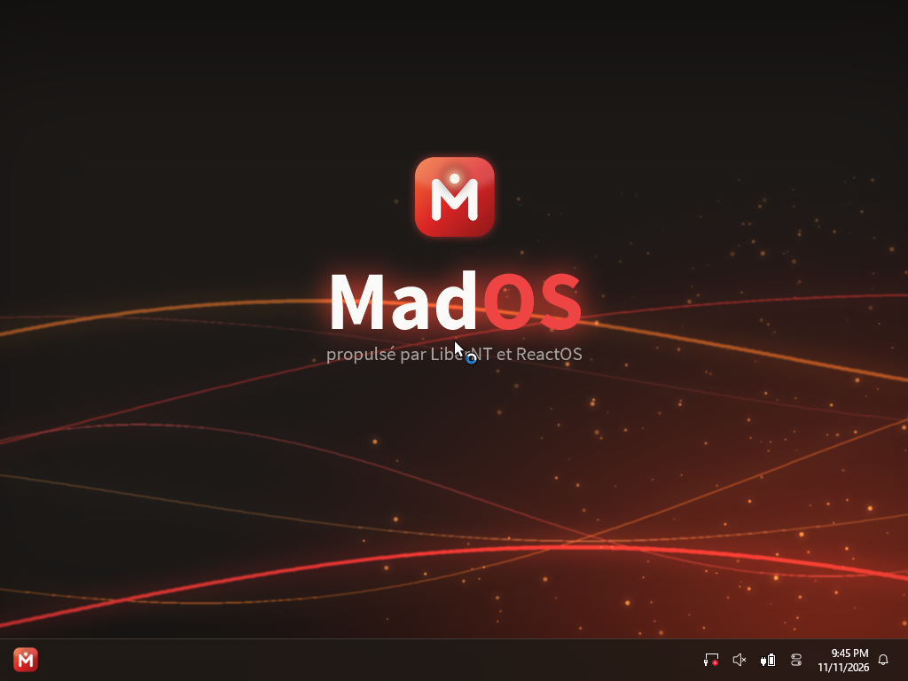
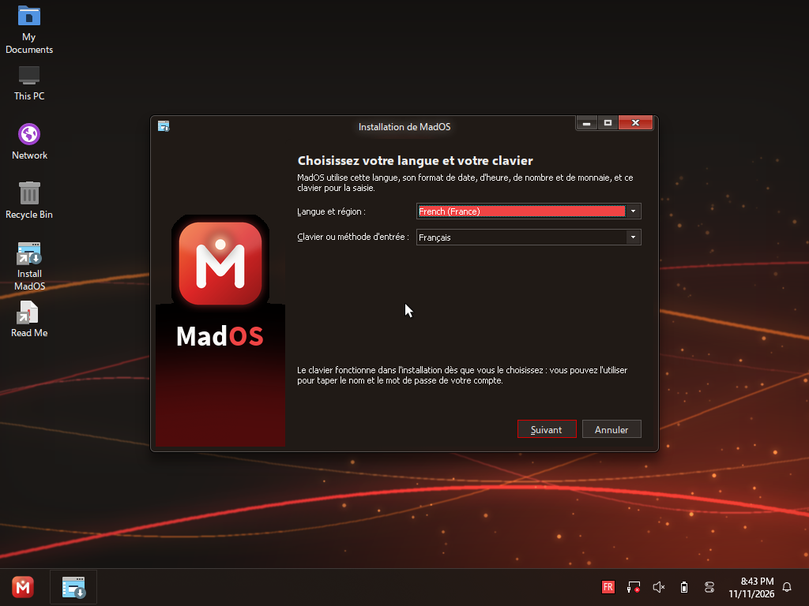
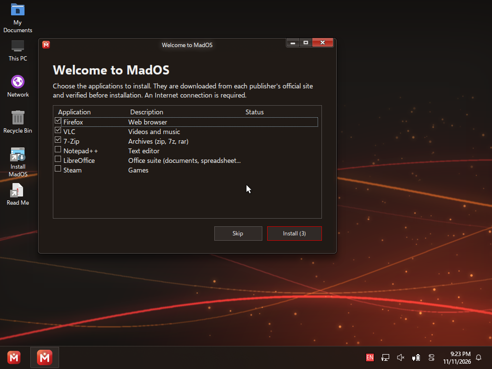
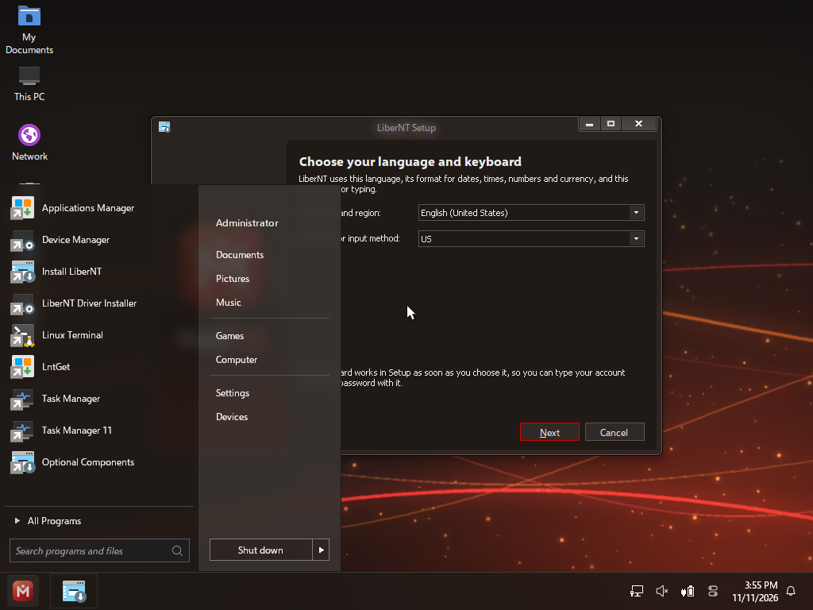
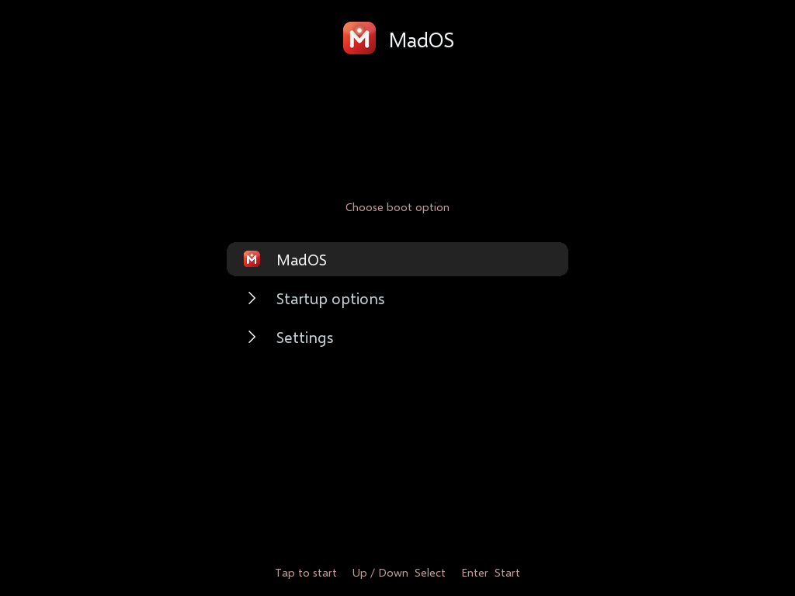
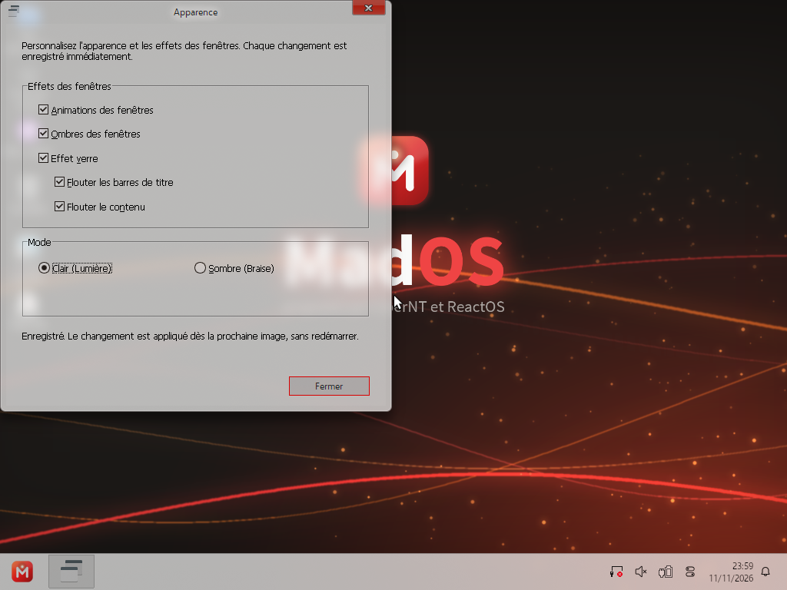
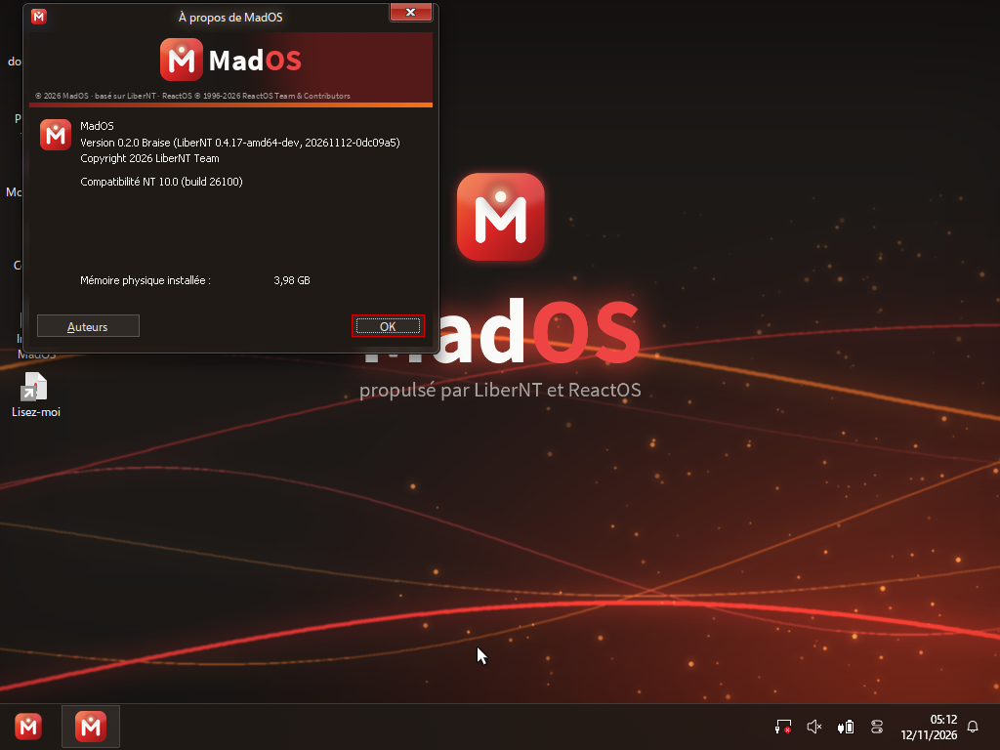

<p align="center">
  
</p>

<p align="center"><b>Un système d'exploitation NT libre, sobre et respectueux.</b><br>
Basé sur <a href="https://github.com/LiberNT/LiberNT">LiberNT</a>, lui-même basé sur <a href="https://reactos.org">ReactOS</a>.</p>

<p align="center"></p>

> **Version expérimentale.** MadOS est un projet jeune : testez-le dans une
> machine virtuelle, pas sur un ordinateur dont vous avez besoin au quotidien.

## Ce qu'est MadOS

MadOS reprend le moteur de LiberNT (noyau NT, pilotes modernes, programmes
Windows en 64 bits) et y ajoute sa propre expérience :

- **Une identité « Braise »** : thème sombre aux accents rouge braise, fond
  d'écran, logo, son de démarrage, écran et menu de démarrage MadOS.
- **Rien n'est envoyé sans votre accord.** LiberNT envoie à chaque démarrage
  un rapport de diagnostic (matériel, identifiants des périphériques…).
  Dans MadOS, c'est coupé par défaut ; vous pouvez l'activer dans le panneau
  Système, avec un texte qui dit exactement ce qui part et où.
- **En français dès le premier écran**, avec le clavier AZERTY : bureau,
  menu Démarrer, applications. Une autre langue reste au choix à
  l'installation.
- **Mode sombre « Braise » ou clair « Lumière »**, au choix dans
  *Apparence* (menu Démarrer), appliqué instantanément.
- **« Bienvenue dans MadOS »** : au premier démarrage, cochez les applications
  que vous voulez (Firefox, VLC, 7-Zip, Notepad++, LibreOffice, Steam, .NET).
  Elles sont téléchargées depuis le site officiel de chaque éditeur et
  **vérifiées avant l'installation** (signature numérique de l'éditeur, ou
  empreinte SHA-256). Rien n'est préinstallé de force.
- **Prêt pour les machines virtuelles** : disque VirtIO (QEMU, KVM, Proxmox),
  OpenGL et Vulkan logiciels (Mesa) installables au premier démarrage.
- **Pilotes Windows sur un vrai PC** : Ethernet, Wi-Fi et Bluetooth avec les
  pilotes officiels des constructeurs (voir plus bas).
- **Plus rapide à démarrer** : le menu de démarrage ne fait plus attendre
  3 secondes ; appuyez sur une touche (F8…) pendant le démarrage pour l'ouvrir.
- **Plus stable** : correction d'une condition de course dans le chargeur de
  DLL qui faisait planter le démarrage de temps en temps.

| | |
|---|---|
|  |  |
| Installation en français | Choix des applications |
|  |  |
| Menu Démarrer | Menu de démarrage (sur demande) |
|  |  |
| Mode clair « Lumière » | À propos de MadOS |

## Essayer MadOS

Téléchargez la dernière version dans
[**Releases**](../../releases) :

- **`MadOS-*-amd64.vhd`** : disque déjà installé. Dans VirtualBox, créez une
  machine « Windows 11 (64 bits) », **EFI activé**, 4 Go de mémoire, et
  utilisez ce fichier comme disque dur.
- **`MadOS-*-amd64.iso`** : installation classique depuis un CD.
- **`MadOS-*-amd64.img.xz`** : pour essayer MadOS sur un vrai PC depuis une
  clé USB (démarrage UEFI ou BIOS). Écrivez-le avec
  [Rufus](https://rufus.ie) ou [balenaEtcher](https://etcher.balena.io),
  qui lisent directement le fichier compressé. **Cela efface toute la clé.**
  Sur un vrai PC, la carte graphique fonctionne en affichage de base
  (pas de pilote Nvidia, AMD ou Intel). Au premier démarrage, laissez
  « Pas maintenant » sur la page qui propose d'agrandir le lecteur C:.

### Utiliser les pilotes Windows de votre PC

MadOS charge les **pilotes Windows officiels** des constructeurs. Testés sur
un portable ASUS : Ethernet Realtek 2.5G, Wi-Fi Intel AX211 (Wi-Fi 6E) et
Bluetooth Intel fonctionnent avec les pilotes de Windows.

1. Sous Windows, exportez vos pilotes (invite de commandes en
   administrateur) : `pnputil /export-driver * C:\Pilotes`
2. Copiez sur une clé les dossiers utiles : réseau (`netwtw…`, `rt…`),
   Bluetooth (`ibtusb…`). **Pas** ceux de Microsoft (ACPI, NVMe, USB).
3. Dans MadOS : *Gestionnaire d'appareils*, clic droit sur l'appareil,
   *Mettre à jour le pilote*, puis le dossier sur la clé.

Ces pilotes appartiennent à leurs constructeurs : MadOS ne peut pas les
fournir lui-même.

## Mesures (VM 4 cœurs / 4 Go)

| | Valeur |
|---|---|
| Du logo de démarrage au bureau | ~7 s |
| Mémoire au repos | ~270 Mo |
| Taille installée | ~510 Mo |

Applications testées (installation et lancement) : Firefox, VLC, 7-Zip,
Notepad++, LibreOffice, Steam. Discord exige le .NET Framework 4.5 : il est
maintenant proposé dans « Bienvenue » (Wine Mono), mais pas encore testé avec
Discord.

## Construire MadOS

MadOS se compile comme LiberNT (voir [README.LiberNT.md](README.LiberNT.md)) :
Linux, macOS, ou Windows via WSL2.

L'identité MadOS est appliquée par un kit de scripts, qui repart toujours des
fichiers de LiberNT et vérifie le résultat :

```sh
python3 media/mados/apply_mados.py      # applique et vérifie l'identité MadOS
cd output-Clang-amd64-debug && ninja liberntvhd
```

Voir [media/mados/README.md](media/mados/README.md) pour le kit et
[media/mados/tests/README.md](media/mados/tests/README.md) pour les tests
automatiques.

## Licence et remerciements

MadOS est distribué sous **GPL-3.0**, comme LiberNT. Il n'existerait pas sans
le travail de l'équipe **LiberNT** et des contributeurs de **ReactOS**
(© 1996-2026 ReactOS Team & Contributors) : merci à eux. Les correctifs
généraux de MadOS (chargeur de DLL, compilation Release…) sont dans des
commits séparés, pour pouvoir être repris par LiberNT.

---

## English

MadOS is a free NT operating system based on [LiberNT](https://github.com/LiberNT/LiberNT)
and [ReactOS](https://reactos.org). **Experimental: try it in a virtual machine.**

- Its own "Ember" look (dark) and a "Light" mode, switchable in *Apparence*.
- **Nothing is sent without your consent**: LiberNT's boot-time diagnostic
  report is off by default and can be turned on in System properties.
- French and AZERTY by default (other languages can be picked during setup).
- "Welcome to MadOS": a first-run app picker that downloads applications from
  each publisher and **verifies them before installing** (publisher signature
  or SHA-256).
- VirtIO disk, software OpenGL/Vulkan (Mesa), faster boot menu.
- Runs the vendors' **Windows drivers** on real PCs: tested with Realtek
  2.5G Ethernet, Intel AX211 Wi-Fi and Intel Bluetooth (install them from
  Device Manager, using the drivers exported from your Windows).

Downloads: [Releases](../../releases) — `.vhd` (ready-made VirtualBox disk,
EFI, 4 GB RAM), `.iso` (installer), `.img.xz` (USB stick, written with Rufus or
balenaEtcher). GPL-3.0.
